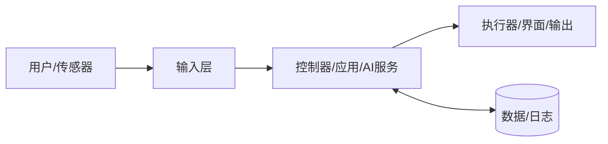

# {{项目名称}}：技术方案

## 项目导航

[[01-项目立项]] · [[02-需求文档]] · [[03-技术方案]] · [[04-项目计划]] · [[05-开发记录]] · [[06-测试记录]] · [[07-问题清单]] · [[08-项目复盘]]

## 1. 方案摘要

- 要解决的核心问题：
- 推荐方案：
- 最大技术风险：
- PoC 结论：未验证 / 通过 / 不通过

## 2. 系统架构

## 3. 模块划分

| 模块 | 职责 | 输入 | 输出 | 技术/器件 | 负责人 |
|---|---|---|---|---|---|
|  |  |  |  |  |  |

## 4. 技术与硬件选型

| 选项 | 优点 | 缺点 | 成本 | 风险 | 结论 |
|---|---|---|---:|---|---|
| 方案 A |  |  |  |  |  |
| 方案 B |  |  |  |  |  |

### BOM / 服务清单

| 类别 | 名称/型号 | 数量 | 单价 | 小计 | 供应商/链接 | 备注 |
|---|---|---:|---:|---:|---|---|
|  |  |  |  |  |  |  |

## 5. 接口与数据

| 接口 | 提供方 | 使用方 | 协议/格式 | 频率/超时 | 错误处理 |
|---|---|---|---|---|---|
|  |  |  |  |  |  |

## 6. 关键流程

1. 
2. 
3. 

## 7. 安全、可靠性与隐私

- 机械/电气/电池安全：
- 急停与故障保护：
- 权限与密钥管理：
- 用户数据与模型数据：
- 日志、监控与恢复：

## 8. PoC 验证

| 假设 | 验证方法 | 通过标准 | 结果 | 结论 |
|---|---|---|---|---|
|  |  |  |  | 待验证 |

## 9. 技术风险

| 风险 | 触发信号 | 概率 | 影响 | 降低风险措施 | 备选方案 |
|---|---|---|---|---|---|
|  |  | 中 | 高 |  |  |

## 10. 技术评审清单

- [ ] 覆盖 [[02-需求文档]] 的全部 P0 需求
- [ ] 关键接口与数据格式明确
- [ ] 最大不确定性已做 PoC
- [ ] 成本、功耗、性能和安全满足约束
- [ ] 有日志、诊断、降级和恢复方案
- [ ] 工作量已同步到 [[04-项目计划]]
